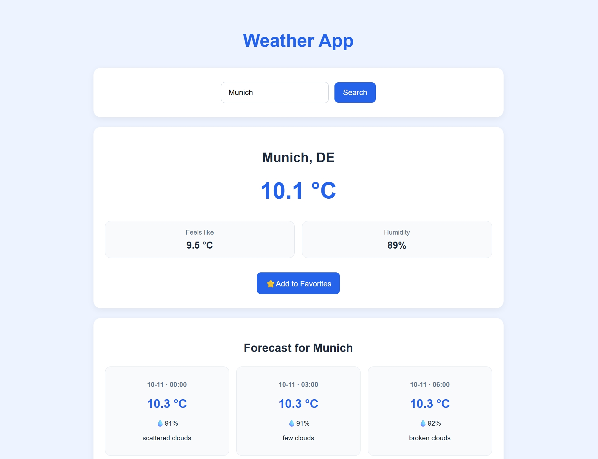

# Weather App 🌤️


A full-stack weather application built with **Java, Spring Boot, React, and PostgreSQL**.


The application allows users to search for real-time weather conditions, view weather forecasts, and manage their favorite cities. It includes user authentication with JWT and a responsive web interface.


## Screenshot





## Features


- Search for current weather conditions by city

- View temperature, feels-like temperature, and humidity

- Display weather forecasts with dates and times

- User registration and login

- JWT-based authentication

- Add and remove favorite cities

- Store user accounts and favorite locations in PostgreSQL

- Responsive interface for desktop and mobile devices


## Tech Stack


### Backend

- Java 25

- Spring Boot 4

- Spring Security

- Spring Data JPA / Hibernate

- PostgreSQL

- JWT Authentication

- OpenWeatherMap API

- JUnit 5 and Mockito

- Maven


### Frontend

- React

- JavaScript

- Vite

- CSS

- Fetch API


## Project Structure


```text

weather-app/

├── weather-api/       # Spring Boot backend

├── weather-frontend/  # React frontend

├── screenshots/       # Application screenshots

├── .gitignore

└── README.md

```


## Getting Started


### Requirements


- Java 25

- Node.js and npm

- PostgreSQL

- OpenWeatherMap API key


Maven does not need to be installed separately because the project includes the Maven Wrapper.


### Backend Setup


1. Create a PostgreSQL database named `weather\_app`.


2. Configure the following environment variables:


```env

WEATHER\_API\_KEY=your\_openweathermap\_api\_key

DB\_PASSWORD=your\_postgresql\_password

JWT\_SECRET=your\_secure\_jwt\_secret

```


Use a securely generated JWT secret of at least 32 bytes.


3. Navigate to the backend directory:


```bash

cd weather-api

```


4. Start the Spring Boot application:


**Windows:**

```bash

mvnw.cmd spring-boot:run

```


**Linux / macOS:**

```bash

./mvnw spring-boot:run

```


The backend runs at:


`http://localhost:8080`


The default database connection uses PostgreSQL at `localhost:5432` with the username `postgres`. These settings can be adjusted in `application.properties`.


### Frontend Setup


1. Navigate to the frontend directory:


```bash

cd weather-frontend

```


2. Install dependencies:


```bash

npm install

```


3. Start the development server:


```bash

npm run dev

```


4. Open the application in your browser:


`http://localhost:5173`


Make sure the backend is running before using the application.


## Testing


Backend unit tests are implemented using \*\*JUnit 5 and Mockito\*\*.


The tests cover:


- Weather data processing

- Invalid city handling

- User registration and duplicate email validation

- Password encoding

- User authentication

- Adding favorite cities

- Preventing unauthorized favorite deletion


Run the backend tests using:


**Windows:**

```bash

mvnw.cmd test

```


**Linux / macOS:**

```bash

./mvnw test

```


Tests that start the full Spring application context may additionally require PostgreSQL and configured environment variables.


## Author


Full-stack portfolio project demonstrating backend development with Spring Boot, frontend development with React, REST API integration, authentication, database persistence, and unit testing.

